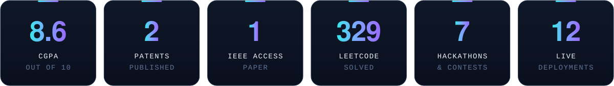
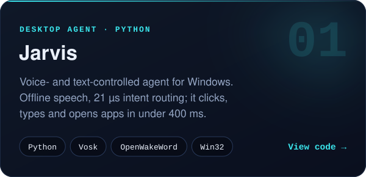
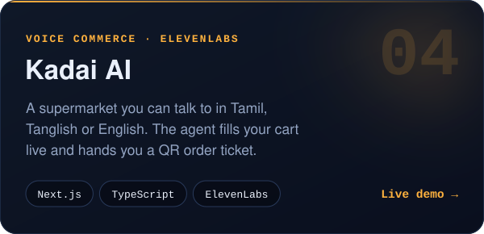
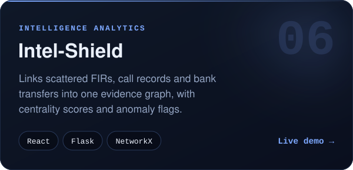
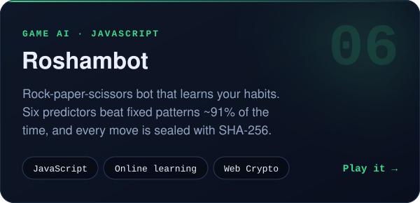
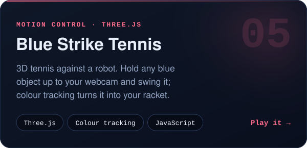
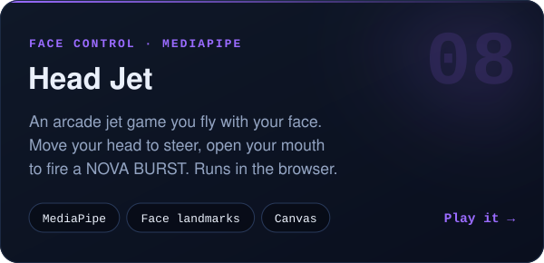

  &nbsp;
  &nbsp;
  &nbsp;
  

## About me

I'm a Computer Science undergrad at **VSB College of Engineering Technical Campus, Coimbatore** (B.E. CSE, 2024 – 28 · CGPA 8.6). I like the part of engineering where an idea becomes something people can actually run: a desktop agent that obeys your voice, a voice agent that speaks Tamil, a portal my whole class uses.

- 🧠 My strongest work sits where **AI / computer vision** meets **full-stack** engineering
- 📜 **2 published patents** (India) and a research paper in **IEEE Access**
- 🏆 National hackathons at **IIT Madras, NIT Trichy, KPR and CIT** · SIH internal-round winner · DEVSPARK'25 runner-up
- 🔭 Going deeper into **system design, TypeScript and applied ML**
- 🎯 Looking for **SDE / AI internships**. The fastest way to reach me is [email](mailto:lakshmanan2062007@gmail.com).

## Featured work

  
  
  
  
  
  

<b>More things I've built</b>

 

| Project | What it is | Link |
|:--|:--|:--|
| **V3 Entertainments** | Multi-page site for a 3D-hologram advertising company. Next.js 14, Tailwind, Framer Motion, PostgreSQL quote form | [Live](https://v3-hologram-website.vercel.app) |
| **SparkPhone QR** | Type a wish or a prank in English, Tamil or Tanglish; an LLM designs a full-screen phone page you share by QR | [Live](https://spark-phone-qr.vercel.app) |
| **Placement Portal** | Next.js 14 + Prisma + Neon Postgres app my class of 63 uses to register hackathon and internship teams, with race-safe first-come slots | Private |
| **OpportunityOS** | Self-hosted tracker that pulls hackathons and internships from Gmail and Unstop, extracts details with an LLM and escalates deadline reminders | Private |
| **25 Online Jobs Guide** | Bilingual Tamil–English career guide: 25 pages generated from one template with a Node.js script | [Live](https://online-jobs-guide.vercel.app) · [Code](https://github.com/lakshmanan272/online-jobs-guide) |

## Research & patents

| | Title | Details |
|:--|:--|:--|
| 📜 **Patent** | **Electrifying the Future: Windmills × Tesla Coils** Wind power sent wirelessly through a Tesla coil, then rectified and stored | Indian patent app. 202441089752 A Published 29 Nov 2024 |
| 📜 **Patent** | **GaiaNet — Quantum-AI Survival Shield** IoT sensor network and AI that predicts disasters, backed by quantum computing | Indian patent app. 202541088719 A Published 17 Oct 2025 |
| 📄 **IEEE Access** | **TIART — Tri-Stage Integrated Attention Residual Transformer** Deep-learning model for rural e-commerce priority prediction | [doi:10.1109/ACCESS.2025.3558391](https://doi.org/10.1109/ACCESS.2025.3558391) |
| 🎤 **ICSAIC 2026** | **Cognitive Phantom Networks** AI hallucination as a self-replicating attack surface in cybersecurity | Paper presented Noorul Islam Centre for Higher Education |

## Hackathons & contests

- 🥇 **Winner** — Smart India Hackathon, internal round · *VSB CETC, 2025*
- 🥈 **Runner-up** — DEVSPARK'25 24-hr hackathon, IEEE CS SYP zonal event · *KPR IET, Sep 2025*
- ⚡ **Pragyan 2026** NextGen Tech Hackathon, 24 hours · *NIT Trichy, Feb 2026*
- ⚡ **Shaastra 2026** Visa 24-hr AI Hackathon, E-Contest and Main Quiz · *IIT Madras*
- ⚡ **CRYPTERA 2026** Vibe Coding, CP Royale and 0xDebug · *CIT Coimbatore, Jan 2026*
- ⚡ **IDEATHON 2K24** — certificate of appreciation · *VSB CETC, Oct 2024*

## Experience

- **Full Stack Web Development Intern** — CodTech IT Solutions, Hyderabad · *Jun – Jul 2025*
- **Full Stack Web Development Intern** — Pantech Prolabs India · *Jun 2025*
- **Full Stack (MERN) MasterClass**, 30 days — Novitech R&D, Coimbatore · *Sep – Oct 2024*

## Toolkit

  
  
  
  

<b>Certifications</b>

 

- **NPTEL** · Programming in Java — Elite + Gold, 92%
- **NPTEL (IIT Kharagpur)** · Cloud Computing, 12 weeks
- **Infosys Springboard** · Angular
- **CSC** · Advanced Diploma in Python Programming — Grade A
- **Udemy** · Data Structures & Algorithms with Java

 

